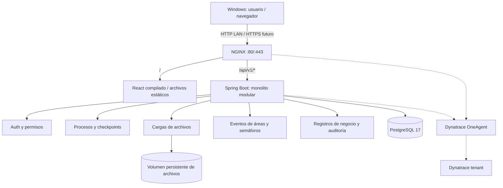
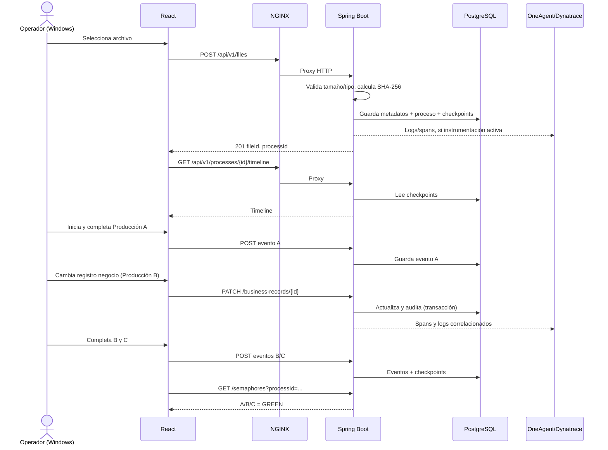
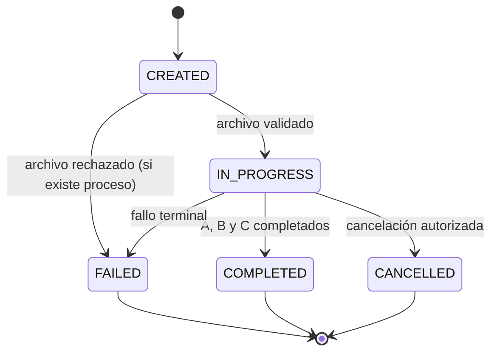
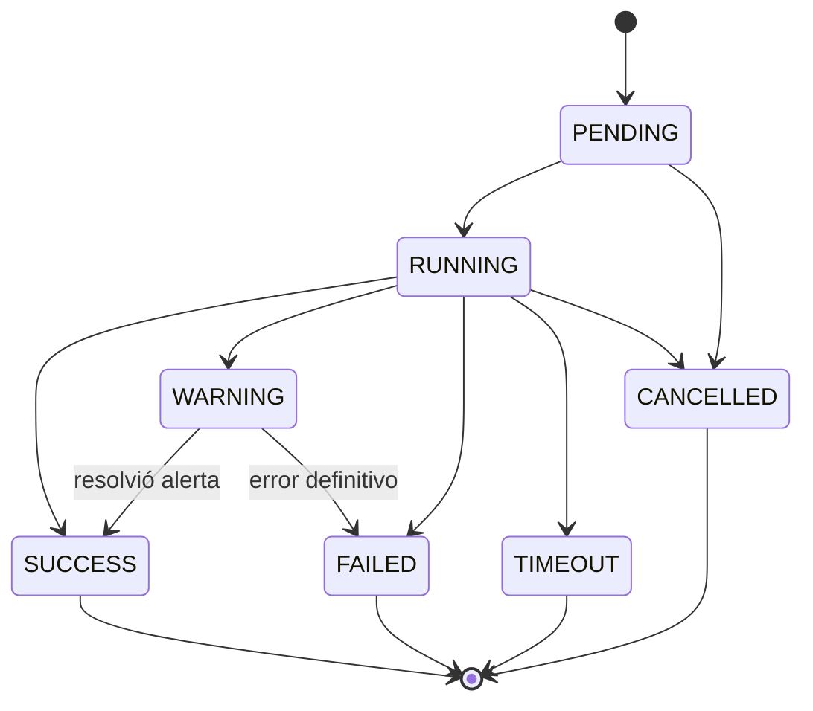

# DT Control Power — Plano maestro de arquitectura y ejecución para orquestador

> **Estado:** especificación de implementación para demo/POC.
> **Versión del plano:** 1.0 · **Fecha:** 2026-11-10
> **Repositorio:** `https://github.com/jaromeDeveloper/dt-control-power`
> **Desarrollo:** Windows, `D:\Repositorios\dt-control-power`
> **Ejecución:** Ubuntu Server 26.04.1 LTS en VirtualBox, `dt-controltower-01`
> **Regla principal:** funcionalidad visible de extremo a extremo con coste de ejecución y tokens controlados; **sin runners, GitHub Actions ni CI/CD automático**.

---

## 0. Instrucción ejecutiva para el orquestador

Actúa como **orquestador de ingeniería Full Stack**. Coordina implementación por incrementos pequeños, con responsabilidades claras entre backend, frontend, infraestructura y QA ligero. El propósito de DT Control Power es demostrar **observabilidad de procesos de negocio de extremo a extremo**, desde carga de archivo, cambio controlado de un registro de PostgreSQL, hasta eventos por área (Producción A, B y C), semáforos, historial y correlación con Dynatrace.

**Prioridades, en este orden:**

1. Funcionalidad real e integrada en demo, no pantallas con datos falsos.
2. Ruta feliz completa y dos fallos demostrables: archivo inválido y evento/operación fallida.
3. Trazabilidad uniforme por `processId`, `checkpointId`, `eventId` y, cuando disponible, `traceId`.
4. Cambios sencillos y mantenibles, mínimos servicios y mínima infraestructura.
5. QA ligero **solo comprueba existencia y conexiones entre funcionalidades**. No hacer pruebas profundas, pentesting, estrés, matriz exhaustiva ni cobertura por porcentaje.
6. No ejecutar `git push`, abrir PR, fusionar, desplegar, modificar VM ni usar credenciales sin autorización humana explícita.

**Antes de escribir:** inspecciona repositorio, ramas y archivos existentes; **no recrees** componentes ya presentes. No presupongas que un endpoint, configuración o prueba existe sin verificarlo. Reutiliza y completa. Si falta información no bloqueante, aplica los valores por defecto que siguen y documenta la decisión. Mantén una sola fuente de verdad para contratos REST y DTO.

### 0.1 Alcance de la demo

**Incluye:** login demo controlado, administración mínima de usuarios/áreas, carga de CSV/TXT/JSON/PDF pequeños, creación de proceso, checkpoints, operaciones sobre registro de negocio, eventos por Producción A/B/C, semáforos, listado, detalle/timeline, panel con métricas simples, auditoría mínima, logs estructurados y telemetría Dynatrace cuando el tenant tenga capacidad confirmada.

**Fuera de alcance:** microservicios, colas externas, Kafka, Redis, Kubernetes, almacenamiento S3, alta disponibilidad, aprobación corporativa compleja, flujos BPMN genéricos, funcionalidades comerciales, análisis semántico del archivo, antivirus integrado, reportes PDF, motor complejo de reglas, WebSockets si el polling basta, IdP corporativo, multitenancy, CI/CD, monitoreo sintético sofisticado y pruebas amplias.

### 0.2 Condición de cierre

Una persona accede desde Windows al servidor Ubuntu mediante NGINX y puede:

1. Iniciar sesión con usuario demo.
2. Subir un archivo válido y ver nombre, tamaño, usuario, fecha, hash y estado.
3. Ver un proceso creado, su ID y sus checkpoints iniciales.
4. Invocar una operación de negocio que modifique un dato de PostgreSQL de forma controlada.
5. Marcar/registrar eventos para Producción A, B, C y ver los semáforos independientes.
6. Ver la línea de tiempo y la auditoría del proceso.
7. Provocar un fallo previsible y verlo como checkpoint/semáforo erróneo.
8. Ver logs correlacionados y, si la ingestión está confirmada, navegar a la traza Dynatrace.

El dashboard siempre debe leer datos reales del backend.

---

## 1. Contexto técnico confirmado y límites de recursos

| Elemento | Situación |
|---|---|
| Host | `dt-controltower-01` |
| Hipervisor | VirtualBox, adaptador puente; Windows ya accede a NGINX |
| Ubuntu | 26.04.1 LTS |
| CPU | 4 vCPU |
| RAM | 7.2 GiB, ~6.0 GiB disponibles al finalizar instalación |
| Swap | 4 GiB configurados, inicialmente sin uso |
| Disco | 58 GiB filesystem, ~44 GiB libres tras instalaciones |
| Docker Engine / Compose | Instalados; Docker 29.9.3 y Compose v5.7.0 vistos |
| Java / Maven | Java 21, Maven 3.9.12 vistos |
| Node / npm | Node 24, npm 11 vistos |
| PostgreSQL | 17 en contenedor, saludable, sin publicación de puerto al host |
| NGINX | Instalado, servicio activo |
| Dynatrace | OneAgent instalado y activo; comprobar trazas para procesos/containers |
| Repositorio | Público, rama principal `master`, monorepo en desarrollo |

**Restricción dura:** no ampliar RAM, CPU ni disco. No introducir un worker JVM separado en la primera versión. No añadir otro Collector de observabilidad hasta comprobar necesidad. Reservar memoria al SO y a OneAgent. PostgreSQL puede continuar en el Compose existente o integrarse en un Compose del repositorio tras planificar migración del volumen existente: **no crear otra base por accidente**.

### 1.1 Presupuesto objetivo aproximado

| Proceso | Objetivo inicial |
|---|---:|
| Ubuntu + sistema + SSH + NGINX | ~1.0–1.3 GiB |
| OneAgent | ~0.2–0.5 GiB |
| Spring Boot, JVM única | `-Xms128m -Xmx768m`, límite contenedor ~1.25 GiB |
| PostgreSQL | límite contenedor ~768 MiB–1 GiB |
| Docker y sobrecarga | ~0.2–0.4 GiB |
| Libre/caché/margen | resto, mantener al menos ~1 GiB de margen operativo |

Estos valores son **propuestas**, no medidas finales. Ajustarlos tras verificar `docker stats`, `free -h`, uso de disco y OneAgent. Compilar preferentemente en Windows para no gastar recursos de la VM.

### 1.2 Parámetros por defecto de demo

| Parámetro | Valor |
|---|---|
| Áreas | `PROD_A`, `PROD_B`, `PROD_C` |
| Archivo máximo | 5 MiB por archivo |
| Formatos | `.csv`, `.txt`, `.json`, `.pdf`, tras validar extensión, tipo y límite |
| Retención archivos | 7 días |
| Retención eventos | 30 días |
| Retención auditoría | 30 días para demo; ampliable por configuración |
| Paginación | 20 elementos, máximo 100 |
| Actualización dashboard | polling cada 5 s; detenerlo al desmontar la pantalla |
| Umbral advertencia área | 60 s sin conclusión, configurable |
| Umbral fallo/timeout área | 180 s, configurable |
| Concurrencia | demo reducida, 3–5 usuarios simultáneos; no prometer 20 sin medir |
| TLS | HTTP solo en LAN durante demo; HTTPS al exponerse fuera de LAN |
| Datos | cuentas y archivos **sintéticos**, nunca datos reales |

---

## 2. Principios arquitectónicos

- **Monolito modular:** una sola aplicación Spring Boot; paquetes por dominio, no microservicios.
- **Contrato REST explícito:** API versionada `/api/v1`, OpenAPI documentado o contrato Markdown/JSON mantenido con código. No duplicar rutas inventadas.
- **PostgreSQL como fuente de verdad:** estados de procesos, checkpoints, eventos y semáforos se calculan desde la base de datos; Dynatrace no es el sistema transaccional.
- **Trazas complementarias:** el seguimiento funcional puede trabajar sin Dynatrace disponible; no bloquear la transacción por fallo de telemetría.
- **Eventos append-only:** eventos e historial de checkpoints sin mutación silenciosa.
- **Una transacción para cambio de negocio y auditoría:** éxito o rollback consistente.
- **Idempotencia sencilla:** cada solicitud con `X-Idempotency-Key` opcional en operaciones que generan cambios; evitar duplicación durante reintentos.
- **Identidad uniforme:** `processId` no es `traceId`; ambos se enlazan cuando hay traza.
- **Roles mínimos:** no exponer escritura anónima ni endpoint arbitrario para ejecutar SQL.
- **Privacidad y seguridad razonables para demo:** no publicar secretos ni rutas de archivos; sanitizar errores y logs.

---

## 3. Arquitectura de componentes



**Aclaración:** el frontend no se ejecuta con `npm run dev` en servidor; NGINX sirve `dist/`. La API solo escucha en loopback o red Docker interna. PostgreSQL no tiene puertos publicados a LAN/Internet. NGINX es la única entrada pública de demo.

### 3.1 Componentes físicos/despliegue

| Componente | Instancia | Responsabilidad |
|---|---|---|
| NGINX | servicio host Ubuntu existente | servir build React, proxy `/api`, límites de carga, cabeceras, logs |
| React | build estático | interfaz, autenticación y consumo REST |
| API Spring Boot | único proceso/contendor | todos los dominios, validaciones y escritura en BD |
| PostgreSQL 17 | contenedor existente | persistencia, transacciones y Flyway |
| Archivos | directorio/volumen persistente privado | binarios de cargas pequeñas, fuera de NGINX |
| OneAgent | agente host | descubrimiento y trazabilidad posible, según soporte/configuración |
| GitHub | repositorio de origen | versionado, PRs y revisión humana, sin pipelines |

---

## 4. Back-end: servicios lógicos obligatorios

Todos se implementan como **módulos/servicios dentro del mismo backend**. No desplegar un contenedor por módulo.

### BE-01 — Identity/Auth Service

**Función:** autenticación mínima y autorización por rol/área. Spring Security con usuarios de demo almacenados de forma controlada (BCrypt) o configurados localmente, **nunca contraseñas en Git**. Sesión segura HttpOnly/SameSite con cookie y protección CSRF apropiada, o token si está debidamente justificado; escoger **una** estrategia y documentarla.

**Roles:** `ADMIN`, `OPERATOR`, `SUPERVISOR`, `AUDITOR`. `OPERATOR` registra eventos solo en áreas autorizadas; `SUPERVISOR` ve todas y puede marcar excepciones; `AUDITOR` lectura; `ADMIN` configuración.

**Endpoints:** `POST /auth/login`, `POST /auth/logout`, `GET /auth/me`, `GET /users` (ADMIN), `GET /areas` (autenticado). Si se usa autenticación por sesión, evitar la necesidad de tokens almacenados en localStorage. En demo se puede prescindir de CRUD completo de usuarios: sembrar 3 usuarios sintéticos de prueba y documentar inicialización segura.

**Criterio:** un usuario puede autenticarse; las rutas de escritura exigen sesión y rol; la UI muestra identidad actual.

### BE-02 — File Ingestion Service

**Función:** recibir archivo, validar 5 MiB, formatos permitidos, crear `fileId`, registrar metadatos, calcular SHA-256 en streaming y escribir fuera de root web. Usar nombre de almacenamiento generado por servidor, no el nombre original. No almacenar binarios en PostgreSQL.

**Endpoint:** `POST /api/v1/files` (`multipart/form-data`: `file`, `areaCode` opcional, `description` opcional). Respuesta 201 con `fileId`, `processId`, `name`, `sizeBytes`, `contentType`, `sha256`, `uploadedBy`, `uploadedAt`, `status`.

**Asociación:** por defecto crea un proceso nuevo y primer checkpoint `FILE_RECEIVED`, seguido de `FILE_VALIDATED` o `FILE_REJECTED`. Si falla validación, devolver 400/413 y registrar evento cuando sea viable. Para archivos totalmente rechazados antes de persistir, el cliente debe mostrar el error incluso si no existe proceso.

**Endpoints de lectura:** `GET /files/{fileId}` metadatos; `GET /files` paginado (opcional si la lista de procesos muestra archivo). **No es requisito descarga** en primer alcance.

**Criterio:** la UI presenta archivo real con usuario/hora/tamaño/hash y enlace al proceso.

### BE-03 — Business Process Service

**Función:** crear, consultar, listar y finalizar proceso. ID UUID. Un proceso representa una carga y sus etapas lógicas. Estados: `CREATED`, `IN_PROGRESS`, `COMPLETED`, `FAILED`, `CANCELLED`. `COMPLETED` solo si las etapas requeridas llegaron a éxito; `FAILED` cuando ocurrió error terminal definido.

**Endpoints:**

- `GET /api/v1/processes?status=&areaCode=&page=&size=`
- `GET /api/v1/processes/{processId}`
- `GET /api/v1/processes/{processId}/timeline`
- `POST /api/v1/processes/{processId}/complete` (SUPERVISOR/ADMIN o regla automática)

**Contenido:** proceso, archivo, responsable, estado global, fecha de creación/cierre, avance de A/B/C y último evento.

**Criterio:** seleccionar un proceso desde la lista abre detalle con timeline real.

### BE-04 — Checkpoint Service

**Función:** persistir cada etapa técnica/funcional. Tipos mínimos `FILE_RECEIVED`, `FILE_VALIDATED`, `BUSINESS_UPDATE_STARTED`, `BUSINESS_UPDATE_COMPLETED`, `AREA_EVENT_RECORDED`, `PROCESS_COMPLETED`; y etapas de error equivalentes. Estados: `PENDING`, `RUNNING`, `SUCCESS`, `WARNING`, `FAILED`, `TIMEOUT`, `CANCELLED`.

**Datos:** UUID, `processId`, `stage`, `areaCode` nullable, `status`, `startedAt`, `finishedAt`, `durationMs`, `actorId`, `errorCode`, `safeMessage`, `traceId` opcional, metadata JSONB.

**Reglas:** una transición de checkpoint debe validar estado previo; registrar cambio en historial. Registrar `RUNNING` y salida solo cuando realmente ocurrió trabajo. No marcar `SUCCESS` si la transacción de negocio falló. No saturar tablas con checkpoints por cada línea de archivo.

**Endpoints:** generalmente internos; lectura por timeline. Se puede añadir `GET /processes/{id}/checkpoints` si el frontend lo necesita.

**Criterio:** cada operación demo produce checkpoints persistidos, ordenados y visibles.

### BE-05 — Business Record Service

**Función:** cambiar un dato demostrativo de PostgreSQL con validación, control de autorización y auditoría.

**Tabla ejemplo:** `business_records(id, process_id, reference, value, version, updated_by, updated_at)`. Usar `value` como texto corto o un campo numérico simple; **evitar operaciones SQL arbitrarias**.

**Endpoints:**

- `GET /api/v1/business-records?processId=`
- `GET /api/v1/business-records/{id}`
- `PATCH /api/v1/business-records/{id}` body `{ "value": "REVISADO" }` (puede soportar `X-Idempotency-Key`)

**Flujo:** autorización → buscar registro → checkpoint RUNNING → actualización en transacción con optimistic locking (`version`) → auditoría de antes/después (campos permitidos) → checkpoint SUCCESS o FAILED → evento de negocio. Al fallar, no auditar como éxito ni emitir evento exitoso. Aclarar cómo se registra el fallo fuera de la transacción revertida.

**Criterio:** la UI modifica el valor, la consulta posterior devuelve nuevo valor, el timeline y la auditoría muestran el evento.

### BE-06 — Production Area Event Service

**Función:** registrar recepción/ejecución/conclusión por Producción A, B y C. Eventos son append-only y llevan `processId`, `areaCode`, `eventType`, `status`, `actorId`, `occurredAt`, `detail`, `traceId` opcional.

**Eventos mínimos:** `RECEIVED`, `STARTED`, `COMPLETED`, `WARNING`, `FAILED`.

**Endpoints:**

- `POST /api/v1/processes/{processId}/areas/{areaCode}/events`
- `GET /api/v1/processes/{processId}/events`
- `GET /api/v1/areas` (catálogo y configuración de timeout)

**Secuencia demo:** A, B y C son **etapas consecutivas por defecto** para la narrativa principal. El diseño de datos mantiene estados separados, permitiendo evolucionar a etapas independientes. Rechazar `COMPLETED` de C si A/B aún no terminaron, salvo opción demo documentada para forzar escenarios.

**Criterio:** cada evento queda guardado, con área/usuario/hora y cambia el estado mostrado.

### BE-07 — Traffic-Light / Semaphore Service

**Función:** calcular color para cada `processId + areaCode`, de acuerdo con su último evento, timeout y estado, sin usar una columna de color como única verdad.

| Estado | Regla simple |
|---|---|
| `GRAY` | área pendiente, sin inicio |
| `YELLOW` | área iniciada y aún en curso, o warning/umbral de advertencia |
| `GREEN` | último estado terminal exitoso `COMPLETED` |
| `RED` | `FAILED` o tiempo mayor al timeout configurado |

**Precedencia:** fallo > completado > timeout > advertencia > pendiente; documentar el caso `COMPLETED` tardío tras timeout (puede pasar a verde guardando la incidencia histórica).

**Endpoints:**

- `GET /api/v1/semaphores?processId=` → A/B/C de ese proceso.
- `GET /api/v1/semaphores/summary` → resumen por área: activos, verdes, amarillos, rojos, grises; distinguir agregación del color de un proceso.

**Criterio:** un evento real cambia color y timestamp en API/UI en la siguiente actualización.

### BE-08 — Dashboard Query Service

**Función:** endpoints de solo lectura para pantalla general y detalle; usar agregaciones SQL eficientes y paginación, sin crear un segundo store.

**Endpoint:** `GET /api/v1/dashboard/summary` con `totalProcesses`, `activeProcesses`, `completedProcesses`, `failedProcesses`, `uploadedFiles`, `semaphores`, `recentEvents` (máx 10).

**Criterio:** totales coinciden con registros creados en demo; sin números hardcodeados.

### BE-09 — Audit Service

**Función:** registrar actor, acción, entidad, estado, fecha y cambios de campos autorizados. No registrar contenidos de archivos, contraseñas, cookies ni tokens.

**Endpoint:** `GET /api/v1/audit?processId=&page=&size=` (SUPERVISOR/AUDITOR/ADMIN).

**Criterio:** se ve quién cambió un registro y el valor anterior/nuevo permitido.

### BE-10 — Observability & Error Handling

**Función:** logs estructurados, correlación y traces. Spring Actuator expone salud interna en endpoint protegido; API pública de negocio usa `/api/v1/health` con respuesta mínima. Incluir `processId` y `traceId` en MDC cuando aplique. Una excepción de BD debe producir error HTTP correcto y checkpoint FAILED cuando exista proceso.

**Estrategia Dynatrace:** confirmar primero auto-instrumentación OneAgent del contenedor/proceso Java, no suponer que `active` equivale a tracing. Añadir instrumentación manual ligera para spans de negocio si el tenant y configuración permiten, evitando doble instrumentación y secretos. Business Events de Dynatrace son **opcionales, condicionados a permisos**: siempre persistir eventos en PostgreSQL primero. No etiquetar `processId` como dimensión de métrica (alta cardinalidad); usar atributos de trace/log.

**Endpoints:** `GET /api/v1/health`; Actuator `GET /actuator/health` solo para localhost/red interna (sin publicar detalles sensibles).

**Criterio:** petición correlacionada desde API hasta logs; en Dynatrace validar captación únicamente si la configuración lo permite.

### BE-11 — Demo Data / Reset Service (opcional controlado)

**Función:** sembrar área y registros sintéticos por Flyway/fixture, permitir reinicio de datos de demo solo de forma explícita. Preferir script local `scripts/reset-demo-data.*` en lugar de endpoint público destructivo. Si existe endpoint, `ADMIN` + modo demo + confirmación requerida.

**Criterio:** demo reiniciable sin manipular manualmente tablas, nunca por visitante anónimo.

---

## 5. Contrato API canónico v1

**Prefijo:** `/api/v1`. **JSON:** camelCase. **Fechas:** ISO-8601 UTC. **IDs:** UUID. **Errores:** `application/problem+json` o JSON uniforme `{code,message,requestId,timestamp}`; documentar decisión. **Autorización:** aplica a escrituras y lecturas de negocio salvo health mínimo. **Paginación:** `page` cero-basada, `size` máximo 100. **Códigos:** 200 GET/PATCH, 201 POST creación, 400 validación, 401 no autenticado, 403 sin permiso, 404 inexistente, 409 conflicto, 413 archivo grande, 500 fallo inesperado.

| Método | Ruta | Backend | Frontend | Mínimo |
|---|---|---|---|---|
| GET | `/health` | Observability | Diagnóstico | Sí |
| POST | `/auth/login` | Auth | Login | Sí |
| POST | `/auth/logout` | Auth | Header | Sí |
| GET | `/auth/me` | Auth | SessionProvider | Sí |
| GET | `/areas` | Areas | Filtros/formularios | Sí |
| POST | `/files` | File Ingestion | UploadPage | Sí |
| GET | `/files/{id}` | File Ingestion | ProcessDetail | Sí |
| GET | `/processes` | Process | ProcessesPage | Sí |
| GET | `/processes/{id}` | Process | ProcessDetail | Sí |
| GET | `/processes/{id}/timeline` | Checkpoint | Timeline | Sí |
| GET | `/processes/{id}/events` | Area Event | EventHistory | Sí |
| POST | `/processes/{id}/areas/{code}/events` | Area Event | AreaAction | Sí |
| GET | `/semaphores?processId=` | Semaphore | ProcessDetail | Sí |
| GET | `/semaphores/summary` | Semaphore | Dashboard | Sí |
| GET | `/business-records?processId=` | Business Record | RecordPanel | Sí |
| GET | `/business-records/{id}` | Business Record | RecordPanel | Sí |
| PATCH | `/business-records/{id}` | Business Record | RecordPanel | Sí |
| GET | `/dashboard/summary` | Dashboard | DashboardPage | Sí |
| GET | `/audit?processId=` | Audit | AuditPage | Sí |
| POST | `/processes/{id}/complete` | Process | ProcessDetail | Opcional si finalización automática |
| GET | `/users` | Auth | Admin | Opcional |

### 5.1 Ejemplos completos de payload

**Archivo: `POST /files`** multipart con `file`, `areaCode=PROD_A` → 201:

```json
{
  "fileId": "ec63a3d9-dc8f-455d-b96e-3b2ace527f79",
  "processId": "dd9f7d96-b5e7-42b5-adbe-042cf833a97e",
  "name": "demo.csv",
  "sizeBytes": 1248,
  "contentType": "text/csv",
  "sha256": "...64_hex_chars...",
  "uploadedBy": "operator-a",
  "uploadedAt": "2026-11-10T23:00:00Z",
  "status": "VALIDATED"
}
```

**Área: `POST /processes/{id}/areas/PROD_B/events`**:

```json
{
  "eventType": "COMPLETED",
  "status": "SUCCESS",
  "detail": "Registro actualizado y validado"
}
```

→ 201:

```json
{
  "eventId": "ca3989b6-ac94-4db6-bd36-98cf2e692e21",
  "processId": "dd9f7d96-b5e7-42b5-adbe-042cf833a97e",
  "areaCode": "PROD_B",
  "eventType": "COMPLETED",
  "status": "SUCCESS",
  "actorId": "operator-b",
  "occurredAt": "2026-11-10T23:01:00Z",
  "semaphore": "GREEN"
}
```

**Semáforos: `GET /semaphores?processId=...`**:

```json
{
  "processId": "dd9f7d96-b5e7-42b5-adbe-042cf833a97e",
  "areas": [
    {"areaCode":"PROD_A","color":"GREEN","status":"COMPLETED","lastEventAt":"2026-11-10T23:00:20Z"},
    {"areaCode":"PROD_B","color":"YELLOW","status":"RUNNING","lastEventAt":"2026-11-10T23:00:50Z"},
    {"areaCode":"PROD_C","color":"GRAY","status":"PENDING","lastEventAt":null}
  ]
}
```

**PATCH registro:** body `{ "value": "REVISADO" }` → resultado con `id`, `processId`, `reference`, `value`, `version`, `updatedAt`; el backend obtiene identidad del usuario autenticado.

### 5.2 Flujo de error

Un error jamás debe responder `status=UP` para operación fallida. Para un archivo demasiado grande retornar `413`; tipo inválido `400`; transición de área inválida `409`. Mensajes seguros y comprensibles para UI. Incluir `requestId` en errores y logs. La API puede devolver `traceId` si está disponible; no fabricar IDs de traza.

---

## 6. Modelo relacional mínimo y Flyway

Preferir migraciones SQL en `backend/src/main/resources/db/migration` y no duplicarlas en `database/migrations`. El directorio `database/` se reserva para fixtures, consultas diagnósticas o documentación.

| Tabla | Columnas principales | Relaciones/índices |
|---|---|---|
| `app_users` | id UUID PK, username UNIQUE, password_hash, display_name, role, active, created_at | username único |
| `production_areas` | code PK (`PROD_A/B/C`), name, warning_after_seconds, timeout_after_seconds, active | seed de tres áreas |
| `user_area_permissions` | user_id, area_code | UNIQUE(user_id, area_code) |
| `uploaded_files` | id UUID PK, original_name, stored_name, size_bytes, mime_type, sha256, uploaded_by, uploaded_at, storage_path, validation_status | UNIQUE(stored_name), FK user |
| `business_processes` | id UUID PK, file_id, created_by, status, started_at, finished_at, description | FK file/user, index(status, started_at) |
| `process_checkpoints` | id UUID PK, process_id, stage, area_code, status, started_at, finished_at, duration_ms, actor_id, trace_id, error_code, safe_message, metadata JSONB | FK process/area; index(process_id, started_at) |
| `checkpoint_status_history` | id UUID PK, checkpoint_id, from_status, to_status, changed_at, actor_id | FK checkpoint |
| `process_events` | id UUID PK, process_id, area_code, event_type, status, actor_id, occurred_at, detail, trace_id, idempotency_key | FK process/area/user, index(process_id, occurred_at), UNIQUE(process_id, idempotency_key) cuando key no null |
| `business_records` | id UUID PK, process_id, reference, value, version, updated_by, updated_at | FK process, index(process_id) |
| `business_record_audit` | id UUID PK, record_id, process_id, actor_id, old_value, new_value, outcome, occurred_at, request_id | index(record_id, occurred_at) |

**Estado del semáforo:** preferentemente **derivado** de `process_events` + timeouts, sin tabla `semaphore_state` al principio. Una consulta/servicio calcula el valor actual; añadir snapshot si aparece un problema real de rendimiento (improbable en demo).

**Invariantes**:

- Los eventos son append-only.
- No eliminar archivos mientras un proceso activo todavía los necesita.
- Un proceso hace referencia al usuario cargador y al archivo.
- Una actualización de negocio nunca se comunica como exitosa si no hizo `COMMIT`.
- Fechas generadas en backend/BD con UTC.
- `metadata` no contiene secretos ni payload del archivo.
- No incluir credenciales iniciales en SQL versionado; provisionarlas por entorno o script local fuera de Git.

---

## 7. Flujo de negocio y estados

### 7.1 Ruta feliz de demostración



**Nota de implementación:** en producción el navegador usa siempre NGINX, aunque el diagrama simplifique algunas llamadas `R → B`.

### 7.2 Reglas del proceso



### 7.3 Reglas de checkpoint



### 7.4 Manejo de fallos demo

- **Archivo inválido:** `400/413`, alerta UI; cuando hay proceso creado, checkpoint `FAILED`.
- **Error BD:** `5xx` o `409` según causa, transacción revertida, log con `requestId`, checkpoint de fallo fuera de la transacción si persiste el contexto.
- **Producción B sin evento:** tras umbral configurado cambia `YELLOW` y luego `RED` por timeout sin necesitar un scheduler complejo; el cálculo puede ser por lectura de timestamp.
- **Dynatrace sin acceso:** la demo continúa; mostrar estado de integración como no verificado, nunca inventar una traza.

---

## 8. Frontend: requerimientos por pantalla y componente

**Stack:** React + TypeScript + Vite; React Router para navegación si es necesario; `fetch` con wrapper tipado, sin Redux ni librerías complejas de datos. CSS simple con variables y componentes reutilizables; evitar introducir grandes paquetes UI. Una sola fuente de endpoints (`src/api/`).

### FE-01 — Shell y navegación

Rutas:

| Ruta | Pantalla | Prioridad |
|---|---|---|
| `/login` | Iniciar sesión demo | P0 |
| `/` | Dashboard | P0 |
| `/upload` | Carga de archivos | P0 |
| `/processes` | Lista de procesos | P0 |
| `/processes/:id` | Detalle + timeline + áreas + registro | P0 |
| `/audit` | Auditoría mínima | P1 |
| `/settings` | Configuración mínima | P2; puede omitirse si valores por backend |
| `/not-found` | Error de ruta | P1 |

**Comunes:** header con nombre del aplicativo, usuario conectado, logout; barra lateral o menú simple; indicadores de carga/error/éxito; diseño responsive básico; colores de semáforo accesibles con texto/icono, nunca solo color.

### FE-02 — LoginPage

Campos usuario/contraseña, botón de entrada, mensaje de error y estado cargando. Tras autenticación, redirect al dashboard. No guardar contraseña, token o datos de sesión sensibles en localStorage. Proteger rutas privadas.

### FE-03 — DashboardPage

Mostrar tarjetas con: total, activos, completados, fallidos, archivos; panel de semáforos agregados por A/B/C; tabla de últimos eventos con hora/área/usuario/proceso; enlace a detalle. Refresco por polling de 5 s; botón Actualizar. No usar hardcodes para conteos.

### FE-04 — UploadPage

Formulario archivo, selector de área inicial y descripción opcional. Validación rápida de extensión/tamaño (sin sustituir backend). Barra de progreso básica si es fácil con XHR, o spinner más texto de estado; no es obligatorio progreso en bytes. Mostrar `fileId`, `processId`, nombre, bytes, hora y usuario; enlazar detalle de proceso. Manejar 400, 401, 413 y 500.

### FE-05 — ProcessesPage

Tabla paginada: proceso, archivo, creador, fecha, estado, A/B/C en mini-semáforos y enlace. Filtros simples por estado y área. Estado vacío real si no existen datos.

### FE-06 — ProcessDetailPage

**Pantalla clave de demo.** Debe contener:

1. Encabezado: ID, estado, archivo, creador y fechas.
2. Tarjeta del archivo: nombre, peso, MIME, SHA-256, usuario, hora.
3. Línea de tiempo de checkpoints ordenados por fecha con `stage`, duración, área, actor, mensaje de error si hay.
4. Semáforo individual A/B/C, estado/último evento/tiempo transcurrido.
5. Acciones autorizadas: registrar `STARTED`, `COMPLETED`, `WARNING` y `FAILED` por área. Botones solo cuando transición válida.
6. Registro de negocio: ver valor actual, editar campo permitido y guardar; refrescar versión/auditoría.
7. Historial de eventos con actor, fecha, tipo y área.
8. Correlación: mostrar `processId`, `requestId`, `traceId` disponible; enlace Dynatrace solo si se conoce URL válida/configurada.
9. Actualización automática moderada y botón refrescar.

### FE-07 — AuditPage

Tabla simple paginada con fecha, usuario, acción, entidad, anterior/nuevo (solo campo seguro), resultado. Filtro por `processId` opcional. Solo roles autorizados.

### FE-08 — Integración HTTP centralizada

- Módulo `src/api/client.ts` con `baseURL='/api/v1'`, `fetch`, headers, errores tipados, credenciales de sesión cuando proceda y gestión de 401.
- Servicios `authApi`, `filesApi`, `processesApi`, `areasApi`, `recordsApi`, `dashboardApi`, `auditApi`.
- Interfaces TypeScript alineadas con DTO backend.
- AbortController en polling y limpieza en `useEffect`.
- No construir URLs de servidor hardcodeadas ni insertar IP de Ubuntu en código.

### FE-09 — Diseño visual

Inspiración tecnológica de observabilidad tipo Dynatrace, **sin copiar marca/logos**. Fondo claro o oscuro coherente; acentos azul/violeta, tipografía legible. Semáforo verde/amarillo/rojo/gris con texto. Estados de carga, vacío, error y éxito. Pantalla de detalle legible a 1366×768 y en móvil básico. No destinar tiempo a animaciones, mapas, gráficos avanzados o bibliotecas pesadas.

### FE-10 — Estados y validación

- Botones bloqueados mientras se envía una operación.
- Mostrar resultado real de API tras cada mutación.
- Evitar doble envío accidental.
- No presentar eventos falsos o fixtures en el dashboard de ejecución.
- Separar error de conectividad del estado de negocio `FAILED`.
- Mensajes accesibles; semáforo con `aria-label`/texto.

---

## 9. Matriz de integración frontend ↔ backend

| Acción UI | API | Persistencia | Resultado visible |
|---|---|---|---|
| Login | `POST /auth/login`; `GET /auth/me` | app_users o configuración demo | Identidad + navegación privada |
| Dashboard | `GET /dashboard/summary`; `GET /semaphores/summary` | procesos/eventos | KPIs + A/B/C |
| Subir archivo | `POST /files` | uploaded_files + business_processes + checkpoints | ID, nombre, tamaño, hash, usuario/hora |
| Ver procesos | `GET /processes` | business_processes | Tabla real |
| Ver detalle | `GET /processes/{id}`, `/timeline`, `/events` | 3 tablas | Timeline y eventos |
| Ver semáforos | `GET /semaphores?processId=` | eventos + reglas de tiempos | A/B/C actualizados |
| Registrar evento | `POST /processes/{id}/areas/{code}/events` | process_events + checkpoint | Semáforo e historial cambian |
| Consultar registro | `GET /business-records?processId=` | business_records | Campo actual |
| Modificar registro | `PATCH /business-records/{id}` | business_records + audit | Valor actualizado y auditoría |
| Ver auditoría | `GET /audit?processId=` | business_record_audit | Actor/hora/antes/después |
| Revisar salud | `GET /health` | sin BD necesariamente | Estado API |

**Regla de entrega:** cada funcionalidad se considera implementada solamente si existe UI → llamada real → endpoint → persistencia/lectura → UI actualizada. El QA ligero verifica esta cadena, no atributos profundos de calidad.

---

## 10. NGINX y despliegue manual en Ubuntu

### 10.1 Rutas

- `/` y rutas de React SPA → `dist/index.html` como fallback.
- `/assets/*` → estáticos compilados con cache headers moderados.
- `/api/*` → Spring Boot en `127.0.0.1:8080` si host, o red Docker interna si container.
- No publicar `:8080`, `:5432` ni `:5173` fuera del host en demo desplegada.
- `client_max_body_size 6m` para archivo de 5 MiB más multipart overhead.
- Encabezados `X-Forwarded-*` y `traceparent` cuando corresponda; no asumir propagación automática de tracing NGINX.

### 10.2 Flujo Git sin runners

```text
Windows: develop -> tests mínimos -> commit -> push -> PR -> revisión humana -> merge master
Ubuntu: git fetch -> checkout/fast-forward master -> ejecutar despliegue manual -> comprobar health/UI
```

El despliegue debe tener un script versionado **invocado manualmente**, que haga preflight (espacio, contenedores, `.env`, estado Git), respalde configuración relevante, aplique actualización, realice health check y dé instrucciones de rollback. Evitar crear/reemplazar PostgreSQL existente hasta identificar nombre de volumen y estado de datos. No hacer `docker compose down -v`, `docker system prune -a` ni `git reset --hard` en scripts.

**Preferencia por recursos:** build de React y JAR en Windows, copiar/publicar artefactos con estrategia aprobada; si el objetivo explícito es `git pull` y build en VM, compilar secuencialmente y controlar memoria. No introducir registro de imágenes privado para esta demo.

### 10.3 Seguridad mínima

- UFW: SSH administrativo y HTTP solo desde LAN autorizada; HTTPS si se expone fuera.
- `.env` fuera de Git, permiso 600 y ejemplos sin valores reales.
- Usuario no root para aplicación; directorio de archivos privado.
- No incluir datos reales en demo pública.
- PostgreSQL sin `ports:` (red interna Docker).
- CORS innecesario bajo NGINX mismo origen.
- No exponer `/actuator/env`, `/actuator/heapdump`, Swagger administrativo ni stacktraces al público.

---

## 11. Dynatrace: requisitos de observabilidad

### 11.1 Checkpoints y correlación

Cada operación de negocio debe generar:

- `requestId`: identificador por petición HTTP (no necesariamente trace ID).
- `processId`: identificador funcional persistente, compartido entre eventos.
- `checkpointId`: etapa individual de proceso.
- `traceId`: únicamente cuando existe traza activa.
- `areaCode`: `PROD_A/B/C` cuando corresponda.
- `operationName`: `file.upload`, `record.update`, `area.event`, etc.

En logs: `timestamp`, `level`, `service`, `operationName`, `processId`, `areaCode`, `requestId`, `traceId`, mensaje breve. **Nunca** password, archivo completo, cookies, tokens o credenciales Dynatrace.

### 11.2 Señales objetivo

| Señal | Qué observar | Mecanismo mínimo |
|---|---|---|
| Request HTTP | código, latencia, tasa de errores | OneAgent si detecta JVM; logs del backend |
| Carga archivo | tamaño, resultado, duración | checkpoint, log estructurado |
| Cambio PostgreSQL | éxito/error y latencia | instrumentación de JDBC/OneAgent si disponible; auditoría |
| Evento por área | área, tipo, estado, actor | `process_events` + log |
| Semáforo | último estado/timeout | consulta backend; no depender de métrica por processId |
| Proceso de negocio | inicio, etapas, fin | logs y spans manuales mínimos si viables |

### 11.3 Integración gradual

**Nivel A — obligatorio:** OneAgent activo, API y BD observables desde el aplicativo, logs correlacionables localmente. **Nivel B — condicionado:** confirmar que Dynatrace capture proceso Java, llamadas HTTP y PostgreSQL. **Nivel C — opcional:** spans manuales y Business Events en Dynatrace si tenant, permisos e ingestión lo permiten. Documentar si cada nivel se verificó o quedó pendiente, sin inventar confirmaciones.

### 11.4 Escenarios demostrables

1. Subida exitosa → `FILE_RECEIVED`, `FILE_VALIDATED` y registro observable.
2. Cambio de dato → transacción PostgreSQL, `BUSINESS_UPDATE_COMPLETED`, actor/hora.
3. Área B `FAILED` → semáforo rojo y log/evento.
4. Área B tardía → amarillo/rojo por tiempo transcurrido.
5. Salto de UI al detalle de proceso; si Dynatrace permite, enlace a traza real.

---

## 12. QA extremadamente ligero: alcance estricto y presupuesto de tokens

**Objetivo exclusivo del agente QA:** certificar **existencia de funcionalidades** y **conexión efectiva frontend ↔ backend ↔ PostgreSQL**. No ejecutar auditorías de calidad, seguridad profunda, performance, accesibilidad formal ni generación masiva de casos. **No modificar código por iniciativa propia.**

### 12.1 Contrato del agente QA

**Entrada:** commit/branch bajo revisión, URL local/backend, credenciales demo proporcionadas de forma segura, entorno de PostgreSQL disponible. **Salida:** máximo 1 tabla compacta y un veredicto. Para cada feature se permite *una prueba feliz sencilla*; para las dos funcionalidades clave (archivo y actualización de negocio) una prueba de error mínima opcional. Reutilizar los datos creados en lugar de generar nuevos por cada endpoint.

### 12.2 Checklist mínimo (10 verificaciones)

| ID | Acción | Evidencia mínima | Resultado |
|---|---|---|---|
| Q01 | Compila backend | comando Maven exit 0 | PASS/FAIL/BLOCKED |
| Q02 | Compila frontend | `npm run build` exit 0 | PASS/FAIL/BLOCKED |
| Q03 | Health responde | GET `/api/v1/health` 200 | PASS/FAIL/BLOCKED |
| Q04 | Login y sesión | login + `GET /auth/me` | PASS/FAIL/BLOCKED |
| Q05 | Upload crea proceso | `POST /files` devuelve fileId/processId | PASS/FAIL/BLOCKED |
| Q06 | Proceso/checkpoints consultables | GET detalle/timeline del proceso subido | PASS/FAIL/BLOCKED |
| Q07 | PATCH persiste | PATCH valor, GET mismo ID devuelve nuevo valor | PASS/FAIL/BLOCKED |
| Q08 | Evento área y semáforo | POST evento A, GET semáforo muestra cambio | PASS/FAIL/BLOCKED |
| Q09 | Dashboard real | GET summary muestra proceso/evento creados | PASS/FAIL/BLOCKED |
| Q10 | UI conectada | navegador muestra dato creado y cambio tras refrescar | PASS/FAIL/BLOCKED |

**No incluir por defecto**: pruebas de carga/concurrencia, fuzzing, pentesting, revisión de dependencias, cobertura, suites E2E grandes, mock-tests adicionales, benchmarks, exploración UX, múltiples navegadores, tests de 20 permisos, simulación de caídas, análisis de perfil de memoria, automatización QA externa.

### 12.3 Política de coste de tokens QA

- Leer **solo** archivos cambiados, contratos/API y rutas necesarias.
- Preferir un **smoke script** de 5–10 llamadas HTTP a documentación extensa.
- No ejecutar varias veces una prueba que ya pasó, salvo cambio que la afecte.
- Un error: reportar ruta, HTTP, esperado, observado, posible propietario; **no depurar durante páginas**.
- No elaborar informes narrativos largos; máximo ~300 palabras de cierre y tabla de diez filas.
- Si una ruta requiere función aún no implementada, marcar `BLOCKED/NOT_IMPLEMENTED`, no simular éxito.
- QA no crea PRs, commits, nuevas dependencias, infraestructura ni workflows.

### 12.4 Separación de responsabilidades

- **Backend agent:** implementa endpoints y pruebas unitarias necesarias para compilar y asegurar lógica base.
- **Frontend agent:** UI y conexión a API real.
- **Infra agent:** NGINX/Compose/scripts, solo cuando se autorice.
- **QA agent:** smoke checks de integración **al final de cada vertical funcional**; no revisa estilo ni hace refactor.
- **Orquestador:** define cortes verticales, integra cambios, acepta riesgos y solicita autorización humana.

### 12.5 Formato de salida de QA

```text
QA SMOKE — incremento <id>
Branch/commit: <...>
Q01 PASS | Q02 PASS | Q03 PASS | Q04 ...
Conexión comprobada: UI → API → PostgreSQL → API → UI [SI/NO]
Bloqueos: <máximo 3 renglones>
VEREDICTO: APTO_DEMO / NO_APTO_DEMO / PARCIAL
```

**Nota:** QA reducido **no equivale a garantía de seguridad ni calidad de producción**. El orquestador debe aplicar validaciones básicas de seguridad/consistencia al implementar, aunque QA no las profundice.

---

## 13. Plan incremental para orquestador (vertical slices)

**No abrir todos los frentes a la vez.** Entregar cortes ejecutables, cada uno con UI, API y dato real cuando corresponda. Orquestador debe distribuir tasks a backend/frontend en paralelo **solo tras fijar contratos**.

| Incremento | Backend | Frontend | Integración/aceptación | QA smoke |
|---|---|---|---|---|
| **I0 Base** | `/health`, estructura Spring Boot, manejo de errores | React shell + health | React muestra `UP` real | Q01–Q03, Q10 parcial |
| **I1 Persistencia** | Flyway, JPA, áreas seed y BD | sin UI nueva | API conecta PostgreSQL existente | Q01/Q03 + consulta BD |
| **I2 Identidad demo** | login/logout/me, roles sencillos | login, shell privado | login real + identidad | Q04 |
| **I3 Archivo/proceso** | upload, metadatos, proceso, checkpoints | Upload + lista + detalle inicial | subir y visualizar ID/hash/usuario/hora | Q05–Q06 |
| **I4 Cambio negocio** | records PATCH + auditoría | edición registro dentro del detalle | PATCH → BD → GET | Q07 |
| **I5 Áreas y semáforos** | eventos A/B/C, reglas, summary | controles de eventos y semáforos | POST evento → color/timeline | Q08–Q09 |
| **I6 Dashboard** | agregaciones summary + lectura audit | Dashboard y auditoría | datos reales/refresco | Q09–Q10 |
| **I7 Observabilidad** | logs, requestId, spans opcionales | IDs de correlación; enlace condicional | registro/traza real cuando disponible | un check de visibilidad, sin investigar en profundidad |
| **I8 Despliegue** | configuración y scripts | build estático | Windows → GitHub → Ubuntu → NGINX | smoke Q03/Q05/Q08/Q10 |

### 13.1 Definition of Done por incremento

- Cambios acotados al incremento y archivo(s) correctos.
- API DTO y frontend coinciden (sin endpoints supuestos).
- Backend compila y arranca o se documenta bloqueo real.
- Frontend compila cuando fue modificado.
- Smoke funcional mínimo realizado o bloqueo explícito.
- No secretos ni datos reales agregados al repo.
- `git diff --stat` y `git status` reportados.
- **No commit/push/merge/deploy automático**; esperar aprobación.

### 13.2 Reglas de agentes para economizar tokens

- Respuestas de agentes: máximo resumen de ~10 líneas, diffs o rutas, comandos y resultado.
- Un único backlog con objetivos y contrato por incremento; evitar repetir el plano completo en cada task.
- No reabrir decisiones aprobadas salvo impedimento técnico.
- Reutilizar código/contratos existentes; no reescribir por preferencias estéticas.
- No ejecutar suites amplias salvo fallo de compilación que exija diagnóstico.
- No llenar el contexto del orquestador con archivos enteros; pasar rutas y extractos relevantes.
- Aislar ownership de archivos para evitar conflictos (backend/*, frontend/*, deploy/*).
- Sin agentes autónomos desplegando ni publicando.

---

## 14. Estructura objetivo del monorepo

```text
dt-control-power/
├── backend/
│   ├── pom.xml
│   ├── mvnw / mvnw.cmd
│   ├── src/main/java/com/controltower/backend/
│   │   ├── config/                 # Spring Security, app config, CORS si aplica
│   │   ├── common/                 # error, correlation, DTO comunes
│   │   ├── auth/                   # identity/auth
│   │   ├── files/                  # File ingestion
│   │   ├── processes/              # process + checkpoints
│   │   ├── areas/                  # events + semaphores
│   │   ├── records/                # business data + audit
│   │   ├── dashboard/              # query aggregations
│   │   └── observability/          # logs/trace enrichment
│   ├── src/main/resources/
│   │   ├── application.yml
│   │   └── db/migration/V*.sql
│   └── src/test/                   # pruebas básicas del código, sin suite extensa
├── frontend/
│   ├── package.json
│   ├── src/
│   │   ├── api/                    # client + typed resource modules
│   │   ├── app/                    # routing/providers
│   │   ├── components/             # navbar, statuses, semaphore, timeline
│   │   ├── pages/                  # login/dashboard/upload/processes/detail/audit
│   │   ├── types/                  # DTOs
│   │   └── styles/                 # tokens CSS básicos
│   └── vite.config.ts
├── database/                       # fixtures y documentación, no migraciones duplicadas
├── deploy/
│   ├── nginx/
│   ├── compose.yaml
│   ├── env.example
│   └── scripts/                   # deploy/revert/check manual
├── docs/
│   ├── architecture/
│   ├── api/
│   ├── observability/
│   └── demos/
├── .gitignore
└── README.md
```

**Importante:** si el repositorio actual ya tiene estructura distinta y válida, adaptar la especificación a lo existente sin desplazamientos masivos.

---

## 15. Requerimientos no funcionales mínimos (no asignarlos al QA exhaustivo)

- **Integridad:** operaciones de negocio con transacción y auditoría coherente; idempotencia en POST cuando sea necesaria.
- **Protección:** autorizar todas las escrituras, contraseñas hasheadas, ningún secreto versionado, validación de archivos y límites de tamaño.
- **Privacidad:** cuentas y registros sintéticos; sin almacenar cuerpos de archivo en logs.
- **Recursos:** una JVM, PostgreSQL ya existente, polling moderado y retención corta; evitar pesadas compilaciones simultáneas en VM.
- **Disponibilidad:** POC sin HA; errores comprensibles y reinicio con datos persistentes.
- **Acceso:** conexión por IP LAN de Ubuntu y NGINX; sin HTTPS externo por ahora.
- **Mantenibilidad:** DTOs tipados y API versionada; comentarios solo donde aportan.
- **Observabilidad:** `processId` en la cadena de eventos; trazas Dynatrace condicionadas a configuración real.

Estas son **obligaciones de implementación** del equipo desarrollador; no justifican extender el rol del QA más allá del smoke solicitado.

---

## 16. Riesgos, decisiones y límites explícitos

| Riesgo | Decisión demo |
|---|---|
| Tenant Dynatrace sin Business Events o dashboards | registrar siempre en PostgreSQL; integración Dynatrace como capacidad verificada u opcional |
| OneAgent activo sin trazas Java | comprobar detección, reinicio controlado del servicio si se autoriza, documentar bloqueo |
| RAM limitada | una JVM; sin segundo worker/Collector; memoria limitada |
| Disco compartido SO/BD/archivos | 5 MiB max, 7 días archivos, logs rotados, nunca hacer prune destructivo |
| Repo público | solo datos sintéticos y ejemplos sin secretos; cambiar a privado si incluye configuraciones sensibles o datos reales |
| Datos PostgreSQL preexistentes | inspeccionar volumen y nombres antes de despliegue; no borrar/crear otra instancia de forma silenciosa |
| Carga simultánea / duplicados | controles simples de envío + idempotencia donde aplique |
| Cliente HTTP LAN sin TLS | solo uso de laboratorio en red confiable; si se requiere exposición externa, HTTPS primero |
| Ausencia de QA profundo | aceptar explícitamente que es demo, no apta para producción |
| Dudas sobre áreas secuenciales vs independientes | **supuesto actual: secuencia A→B→C para demo**; estructura conserva área individual; no construir motor de orquestación genérico |

---

## 17. Instrucción de ejecución inmediata al orquestador

1. Leer `git status`, rama activa, `README.md`, `backend/pom.xml`, `frontend/package.json` y rutas existentes.
2. Preparar una **matriz GAP**: `EXISTE / PARCIAL / FALTA`, sin escribir informes extensos.
3. Empezar desde el primer incremento no completado: **I0** React ↔ Spring Boot, si aún falta; no asumir que ya terminó.
4. Fijar contrato API por incremento y asignar archivos sin solapamiento a agentes.
5. Implementar **solo un incremento a la vez**, salvo autorización explícita para agruparlos.
6. Backend y frontend realizan compilación mínima; QA smoke comprueba existencia y conexión de la funcionalidad del incremento.
7. Entregar reporte compacto: `incremento`, `archivos`, `endpoints`, `pantallas`, `comandos/veredicto`, `riesgos`, `git status`.
8. **Detenerse a esperar aprobación humana.** Nunca enviar push, abrir PR, fusionar o desplegar sin ella.

### Plantilla de salida del orquestador

```text
DT CONTROL POWER / <Incremento>
Estado: COMPLETO | PARCIAL | BLOQUEADO
Branch: <...>
Implementado: <módulos/rutas/archivos principales>
Integración UI→API→BD: <confirmada / parcial / pendiente>
QA smoke: <Qxx PASS/FAIL/BLOCKED, resumido>
Validaciones: <comandos ejecutados, salida exit/fail>
Riesgos/decisiones: <máximo 3>
Cambios git: <status y diff stat>
Requiere autorización para: <commit/push/PR/deploy/siguiente incremento>
```

---

## 18. Glosario breve

- **Proceso:** instancia de negocio creada a partir de una carga.
- **Checkpoint:** cambio de etapa o estado con tiempos y resultado.
- **Evento:** hecho registrado por un área, append-only.
- **Semáforo:** estado interpretado de un área en un proceso, derivado de eventos/tiempos.
- **Trazabilidad funcional:** IDs y datos persistidos en PostgreSQL para reconstruir la historia.
- **Observabilidad técnica:** logs, métricas y trazas instrumentadas y, si están disponibles, ingeridas por Dynatrace.
- **Smoke QA:** prueba mínima de que existe funcionalidad y está conectada; no auditoría integral.

**Fin del plano maestro.**
